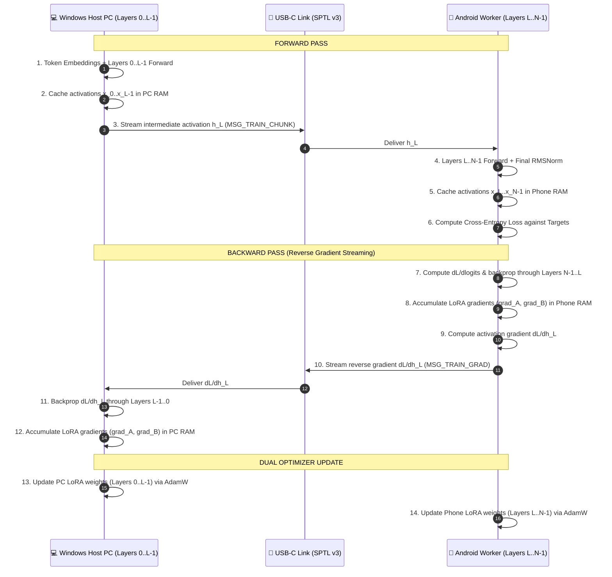

# Distributed LoRA Training (Reverse Gradient Streaming)

## Overview
**AndiRun Distributed LoRA Training** allows fine-tuning large language models (7B, 14B, 32B) across a **Windows PC (host)** and **Android phone (co-processor)** over a single USB-C cable.

By distributing the model across devices and streaming intermediate activations forward and **reverse gradients backward** across USB, both devices contribute their RAM to store activations, optimizer states (AdamW), and LoRA parameters without any single machine running out of memory.

---

## 🏛️ Reverse Gradient Streaming Pipeline



---

## ⚡ Mathematical Formulation

1. **Parameter Splitting:**
   - For layer $l$:
     $$W_l = W_{0,l} + \frac{\alpha}{r} B_l A_l$$
     where $A_l \in \mathbb{R}^{r \times d}$, $B_l \in \mathbb{R}^{d \times r}$.
   - PC holds $A_l, B_l$ for $0 \le l < L$.
   - Phone holds $A_l, B_l$ for $L \le l < N$.

2. **Activation Gradient Transfer:**
   - At boundary layer $L$, the incoming activation is $h_L$.
   - In the backward pass, the phone evaluates the gradient with respect to this activation:
     $$g_{h_L} = \frac{\partial \mathcal{L}}{\partial h_L}$$
   - $g_{h_L}$ is serialized and streamed across the USB socket as `MSG_TRAIN_GRAD_DATA`.
   - The PC resumes backpropagation:
     $$\frac{\partial \mathcal{L}}{\partial x_{L-1}} = \left(W_{0, L-1} + \frac{\alpha}{r} B_{L-1} A_{L-1}\right)^T g_{h_L}$$

3. **Memory Savings:**
   - Neither the host nor the phone holds the full model's activations or optimizer states.
   - For a 7B model with AdamW:
     - Full single-node training requires $> 28\text{ GB}$ of RAM.
     - With AndiRun split $L=20$: Host uses $\approx 14\text{ GB}$, Android phone uses $\approx 6.5\text{ GB}$.

---

## 🚀 How to Run Distributed Training

```powershell
python andirun-main\scripts\distributed_lora_train.py `
    -m qwen-7b.gguf `
    -L 20 `
    -d dataset.txt `
    --lora-r 8 `
    --lora-alpha 16.0 `
    --lr 2e-4 `
    --epochs 3 `
    -o finetuned-lora.gguf
```

### Loading the Trained LoRA Adapter
Once training completes, the exported `finetuned-lora.gguf` can be applied during distributed inference:
```powershell
python andirun-main\scripts\serve_win_android.py `
    -m qwen-7b.gguf `
    -L 20 `
    --server-bin build-win\bin\llama-server.exe `
    --extra-args "--lora finetuned-lora.gguf"
```
