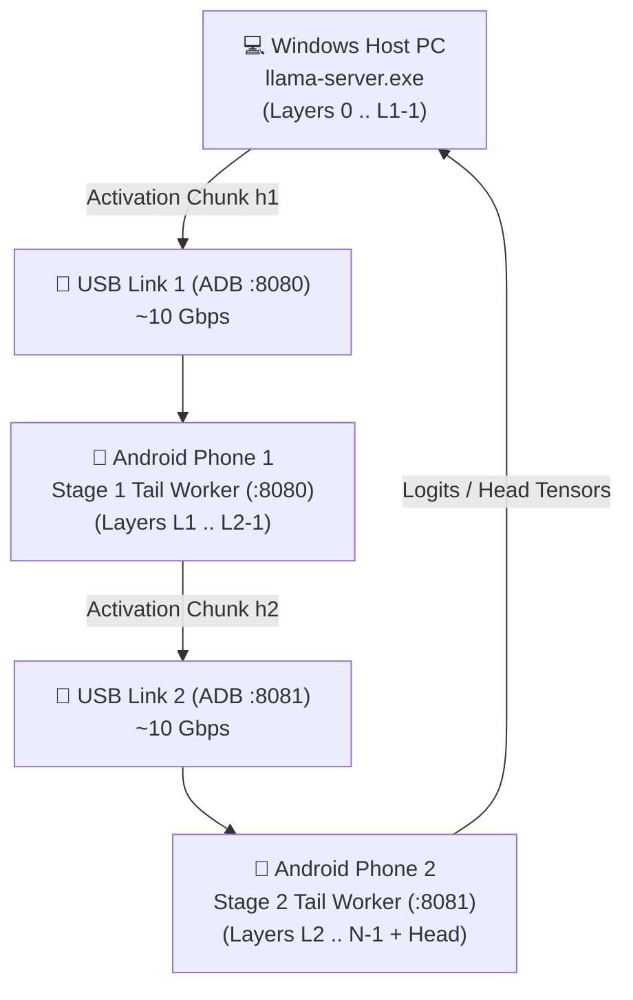

# Multi-Device Mesh Architecture

## Overview
**AndiRun Multi-Device Mesh** allows scaling inference and context across **2 or more Android phones** simultaneously connected to a single Windows PC host over USB-C cables.

---

## 🏗️ Topology & Communication Flow



---

## ⚡ Two Mesh Modes

### 1. Pipelined Layer Mesh (Model Offloading)
For models too large to fit comfortably in a single phone or host alone:
- **Partitioning Example (28-layer model on PC + 2 Phones):**
  - **PC Host:** Layers 0 to 15 (Embedding + First 16 layers)
  - **Phone 1:** Layers 16 to 21 (Intermediate stage)
  - **Phone 2:** Layers 22 to 27 + Output Projection Head
- **Bandwidth Efficiency:** Only activation vectors (a few kilobytes per chunk) are exchanged across USB links. Model weights remain stationary on each device's local memory.

### 2. Attention Context Mesh (128k – 262k+ Tokens)
For ultra-long contexts where holding the KV cache would exceed a single phone's RAM:
- **Phone 1:** Holds KV tokens $[0, 64\text{k})$ on local Vulkan device memory (Port `50062`).
- **Phone 2:** Holds KV tokens $[64\text{k}, 128\text{k})$ on local Vulkan device memory (Port `50063`).
- **Host:** Computes current tokens and broadcasts queries $Q$ to both phones in parallel.
- **Log-Sum-Exp 3-Way Merge:** The host merges partial attention tensors from Phone 1, Phone 2, and local computation with 100% mathematical precision.

---

## 🚀 Quickstart: Running Multi-Device Mesh

### 1. Slice Stages for Each Phone
```bash
# Stage 1 for Phone 1 (layers 16..22)
python andirun-main/scripts/split-gguf.py -m qwen-7b.gguf -L 16 --until 22 -o stage1.gguf --no-head

# Stage 2 for Phone 2 (layers 22..28 + head)
python andirun-main/scripts/split-gguf.py -m qwen-7b.gguf -L 22 -o stage2.gguf
```

### 2. Push Stages to Respective Devices
```bash
adb -s <SERIAL_PHONE_1> push stage1.gguf /data/local/tmp/
adb -s <SERIAL_PHONE_2> push stage2.gguf /data/local/tmp/
```

### 3. Launch the Mesh Orchestrator
```powershell
python andirun-main\scripts\mesh_orchestrator.py -m qwen-7b.gguf --total-layers 28 --host-share 0.5
```
The orchestrator will:
1. Discover all connected Android phones.
2. Bind loopback port forwarding (`8080/50062` for Phone 1, `8081/50063` for Phone 2).
3. Verify SPTL and Vulkan attention health on each node.
4. Launch `llama-server.exe` with distributed pipeline routing enabled.
