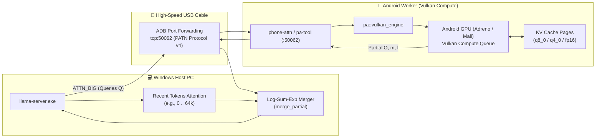

# Vulkan Attention Offload (`phone-attn`)

## Overview
**AndiRun** utilizes Vulkan Compute on Android phones to offload long-context Attention calculation (up to **128k+ tokens**).
This replaces the Apple-specific Metal (`pa-metal.mm`) and Neural Engine (`pa-ane.mm`) implementations with an open, cross-platform Vulkan Compute pipeline compatible with Qualcomm Adreno (Snapdragon), ARM Mali, and Immortalis mobile GPUs.

---

## 🏗️ Architecture



---

## ⚡ How It Works

1. **KV Cache Storage on Phone RAM:**
   - As tokens are processed, the oldest key-value pages ($[0, K_{\text{old}}]$) are appended to the Android phone via `APPEND` messages over port `50062`.
   - Pages can be stored in **`q8_0`** (1 byte/element + scale), **`q4_0`** (0.5 byte/element + scale), or **`fp16`**.
   - An 8 GB Android phone can easily hold **130,000 to 260,000 tokens** of quantized KV cache.

2. **Parallel GPU Attention Dispatch:**
   - For every attention computation, the Windows Host evaluates queries $Q$ for the current batch.
   - The host sends $Q$ across the USB cable via `ATTN` / `ATTN_BIG` requests.
   - `pa::vulkan_engine` dispatches a compute dispatch across Vulkan compute pipelines.
   - Each compute workgroup processes a KV head and key chunk using online softmax:
     $$S_j = \frac{Q \cdot K_j}{\sqrt{d}}$$
     $$m_{\text{new}} = \max(m, S_j), \quad l_{\text{new}} = l \cdot e^{m - m_{\text{new}}} + e^{S_j - m_{\text{new}}}$$
     $$O_{\text{new}} = O \cdot e^{m - m_{\text{new}}} + e^{S_j - m_{\text{new}}} \cdot V_j$$

3. **Lossless Log-Sum-Exp Merge:**
   - The phone returns unnormalized output vectors $O$, maximum score $m$, and exponential sum $l$.
   - The Windows host merges the phone's partial attention output with its local attention output using exact Log-Sum-Exp arithmetic:
     $$M = \max(m_{\text{host}}, m_{\text{phone}})$$
     $$O_{\text{final}} = \frac{O_{\text{host}} e^{m_{\text{host}} - M} + O_{\text{phone}} e^{m_{\text{phone}} - M}}{l_{\text{host}} e^{m_{\text{host}} - M} + l_{\text{phone}} e^{m_{\text{phone}} - M}}$$
   - **Parity Guarantee:** Bit-exact with running the full 128k context on a high-end workstation.

---

## 🛠️ Building & Running

### On Android (Termux):
```bash
pkg install -y git cmake clang make
cd andirun/andirun-main/phone-attn
bash build.sh

# Start the Vulkan attention listener on port 50062
./build/pa-tool serve 50062
```

### On Windows Host (testing / loopback):
```powershell
cd andirun-main\phone-attn
.\build-win.bat
.\build\pa-tool.exe serve 50062
```
